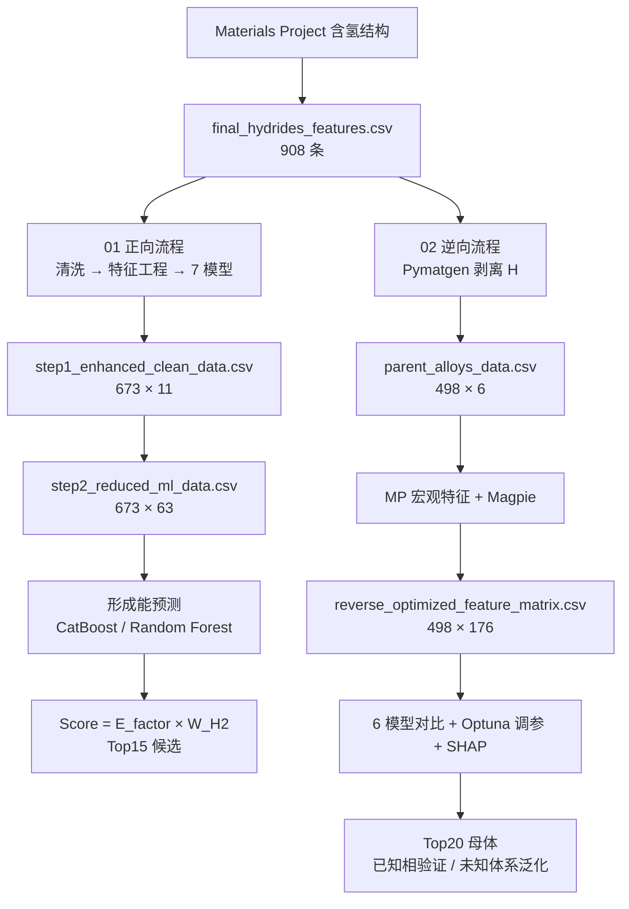

# 储氢材料机器学习流程：正向与逆向

从 Materials Project 理论数据出发的两条储氢材料筛选流程——**正向**预测氢化物形成能，**逆向**由氢化物反推母体合金并预测其最大理论储氢容量。两条流程共享同一套候选评分逻辑（`Score = E_factor × W_H2`），但数据对象、特征边界与选模规则分别定义。

配套的交互式汇报网页：[hydrogen-storage-ml-report](https://hahashen567-lab.github.io/hydrogen-storage-ml-report/)

---

## 1. 仓库内容

为保持 notebook 内的相对路径可以直接运行，数据文件与 notebook 放在同一层；下载后整目录用 Jupyter 打开即可。

| 文件 | 说明 | 规模 |
| --- | --- | --- |
| `01_forward_hydride_pipeline.ipynb` | 正向流程：氢化物组成/结构 → 形成能 → 候选评分 | 2.7 MB |
| `02_reverse_parent_alloy_pipeline.ipynb` | 逆向流程：氢化物剥离 H → 母体合金 → 理论容量 → Top20 | 0.5 MB |
| `final_hydrides_features.csv` | MP 含氢结构原始特征宽表 | 908 × 15 |
| `step1_enhanced_clean_data.csv` | 正向第一步清洗结果（含晶系、空间群、凸包能） | 673 × 11 |
| `step2_reduced_ml_data.csv` | 正向特征工程后的建模矩阵（Magpie + 物理特征） | 673 × 63 |
| `parent_alloys_data.csv` | 逆向第一步：剥离 H 后的母体合金基准表 | 498 × 6 |
| `parent_alloys_optimized_labels.csv` | 母体合金标签体系（多相聚合、最佳热力学窗口） | 498 × 17 |
| `reverse_mp_features_cache.csv` | 母体合金的 MP 宏观物性缓存（密度、体积、带隙、磁矩、凸包能） | 498 × 6 |
| `reverse_optimized_feature_matrix.csv` | 逆向完整设计矩阵（紧凑描述符 + Magpie 互补特征） | 498 × 176 |
| `reverse_optimized_run_metadata.json` | 一次优化运行的配置、交叉验证汇总、最终指标与保留特征 | 7.9 KB |
| `reverse_top20_known_validation.csv` | 逆向 Top20：已知相验证排序 | 20 × 25 |
| `reverse_top20_unknown_generalization.csv` | 逆向 Top20：未知体系泛化排序 | 20 × 25 |

> 未包含：`catboost_info/`（训练日志）、`MP_Hydrogen_Alloys_Cache.pkl`（可重建的 MP 缓存）、`Final_ML_Gold_Features.csv`（notebook 内部中间产物，见 `.gitignore`）。

## 2. 数据流



## 3. 正向流程（`01_forward_hydride_pipeline.ipynb`）

从 MP 直接拉取带 H 的结构宽表，逐级清洗后预测形成能：

1. **数据抓取与 EDA**：除形成能外，额外抓取晶系、空间群、凸包能（`Energy Above Hull`）等“可制备性”因子。
2. **组分复杂度剔除**：剔除五元及以上配方，降低白噪声；输出 `step1_enhanced_clean_data.csv`（673 条）。
3. **晶系构效探索**：观察不同晶系在热力学最佳释放窗口 `[-0.5, 0] eV/atom` 的分布。
4. **特征工程**：Magpie 132 维组分特征 + 储氢专属特征（氢质量分数、H/M 比）+ 基础物理特征，单步 Spearman 剪枝（阈值 0.75）后输出 `step2_reduced_ml_data.csv`。
5. **防泄漏切分**：先按 80/20 切分，再仅用训练集统计量做标准化。
6. **七模型对比 + 贝叶斯调参**：Ridge / SVR / Decision Tree / Random Forest / XGBoost / LightGBM / CatBoost，`n_iter=40`、10 折 KFold，并按 `Test R² - 0.5 × (Train-Test Gap)` 排序。
7. **评分与筛选**：`Score = E_factor × W_H2`，剔除贵金属与单一碱金属体系，输出 Top15。

留出集（135 条）上的基线表现：

| 模型 | Train R² | Test R² | Test RMSE | Test MAE |
| --- | ---: | ---: | ---: | ---: |
| Random Forest | 0.9550 | **0.8143** | 0.1360 | 0.0856 |
| CatBoost | 0.9312 | 0.8131 | 0.1364 | 0.0907 |
| XGBoost | 0.9975 | 0.8107 | 0.1373 | 0.0860 |
| LightGBM | 0.9690 | 0.8071 | 0.1386 | 0.0930 |
| Ridge | 0.6368 | 0.6059 | 0.1981 | 0.1437 |
| SVR | 0.9048 | 0.5678 | 0.2075 | 0.1148 |
| Decision Tree | 1.0000 | 0.4056 | 0.2433 | 0.1236 |

树模型明显优于线性基准，但 XGBoost / Decision Tree 的训练集 R² 接近 1，需要结合调参后的 Train-Test Gap 判断过拟合程度。

## 4. 逆向流程（`02_reverse_parent_alloy_pipeline.ipynb`）

核心思路：现有氢化物 → 用 Pymatgen 剥离 H → 还原母体合金最简式 → 对“同一种合金多种吸氢相”做聚合去重 → 预测母体理论容量。

| 阶段 | 内容 |
| --- | --- |
| 1–3 | 加载 908 条含氢数据、定义物理剥离函数、计算容量、处理一对多坍缩、生成 `parent_alloys_data.csv`（498 条母体） |
| 4–5 | 元素周期表频次热图、母体元数分布诊断 |
| 6–8 | MPRester 抓取宏观物性；Matminer 计算 Magpie 特征；打包融合特征矩阵 |
| 9 | KNN 物理插补缺失值 |
| 10–10.5 | 方差过滤 → 共线性过滤（Spearman > 0.95）→ 随机森林重要性排序取 Top30；降维前后共线性热图 |
| 11–11.6 | 按“基底金属 × 元数”双维分层抽样 8:2，并可视化验证训练/测试分布均衡性 |
| 12–15 | 多模型竞技（RF / ExtraTrees / GBDT / SVR / XGBoost 等）、冠军模型奇偶图、残差与误差密度 |
| 16 | Optuna 3 折分层交叉验证调参 |
| 17 | SHAP 蜂群图与条形图解释 |
| 18 | 调参后模型的奇偶图与残差诊断 |
| 19–20 | 双向自洽验证，输出 Top20 母体名单与多维物理重叠组合图 |

> 498 个母体中，27 个作为**完全隔离的外部实验验证集**（HydPARK 重合配方），其余 471 个参与建模；汇报网页中的“471 / 27”即来自这里。

## 5. 结果口径

以下数字与汇报网页一致，便于交叉核对：

- 正向：673 条去重氢化物，固定 80/20 留出（538 训练 / 135 测试）。
- 逆向：471 条建模母体 + 27 条严格外部验证；训练集 GroupKFold 选模，另设 376/95 展示划分。
- 跨流程：10 个共同母体，Top15 重合率 66.7%。
- 数据基础：MP、JARVIS、HydPARK、HyStor 的独立筛选与字段对照。

## 6. 环境与运行

```powershell
# Python 3.9–3.11 均可（notebook 原始环境为 3.9.25）
conda create -n h2ml python=3.10 -y
conda activate h2ml
pip install -r requirements.txt

# Materials Project API Key（https://materialsproject.org/api）
$env:MP_API_KEY = "your-key-here"

jupyter lab
```

运行顺序：在同一目录下先跑 `01_forward_hydride_pipeline.ipynb`，再跑 `02_reverse_parent_alloy_pipeline.ipynb`。逆向流程的 cell 11 会生成中间文件 `Final_ML_Gold_Features.csv`，cell 13 读取它，因此请**从上到下顺序执行**，不要跳步。

## 7. 已知限制

- **MP 数据库会更新**。仓库内的 CSV 是 2026-04 的快照；重跑抓取可能得到不同的条目数，指标也会随之变化。
- notebook 保留了执行输出（含图表），因此文件较大，但可直接在 GitHub 上预览结果图。
- `reverse_optimized_*` 系列文件是配套优化脚本的运行快照（该脚本未包含在本仓库），也是汇报网页 Top 表的来源；notebook 本身输出的是 `parent_alloys_data.csv` 与 `Final_ML_Gold_Features.csv`。
- 模型指标只反映留出集/交叉验证表现，不替代结构机理或实验性能证明；SHAP 与跨流程交集属于模型证据。

## 8. 说明

- 作者：沈子钧
- 汇报网页：[hydrogen-storage-ml-report](https://hahashen567-lab.github.io/hydrogen-storage-ml-report/)
- 本仓库未声明开源许可证；如需复用代码或数据，请先联系作者。
